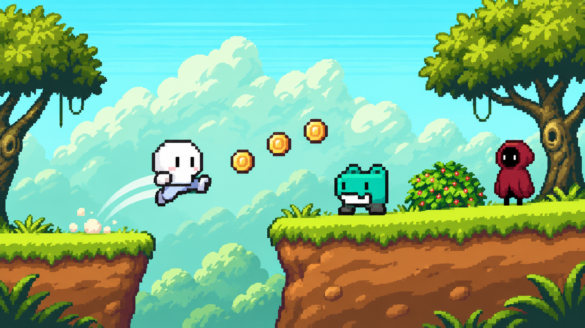
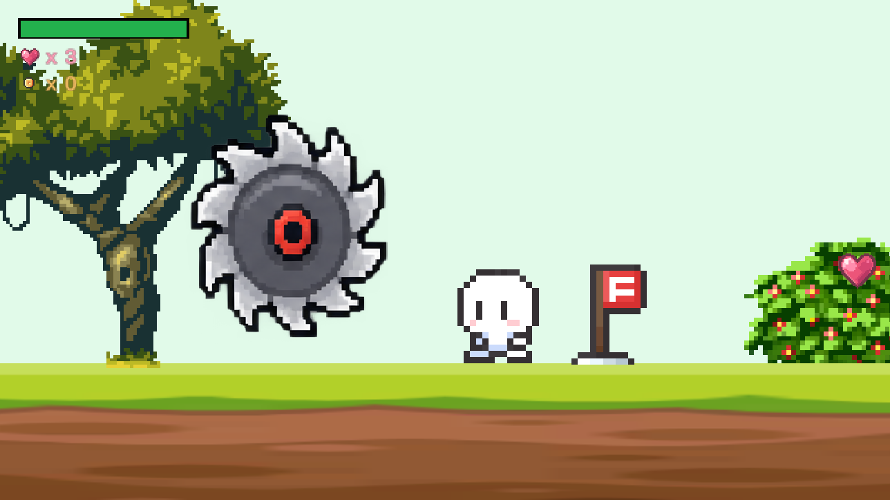
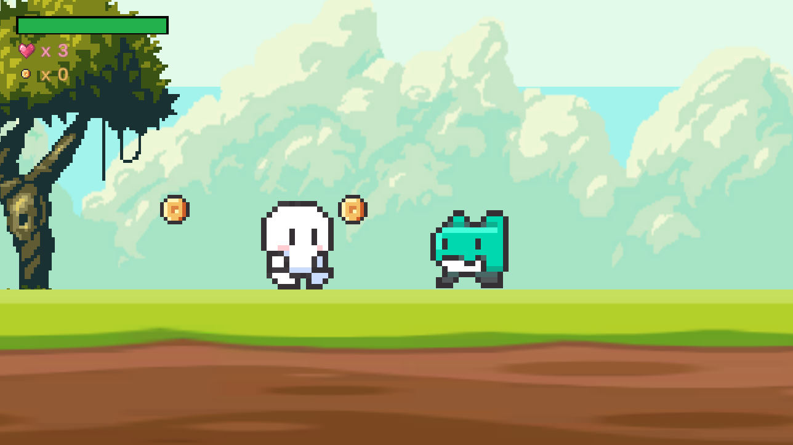
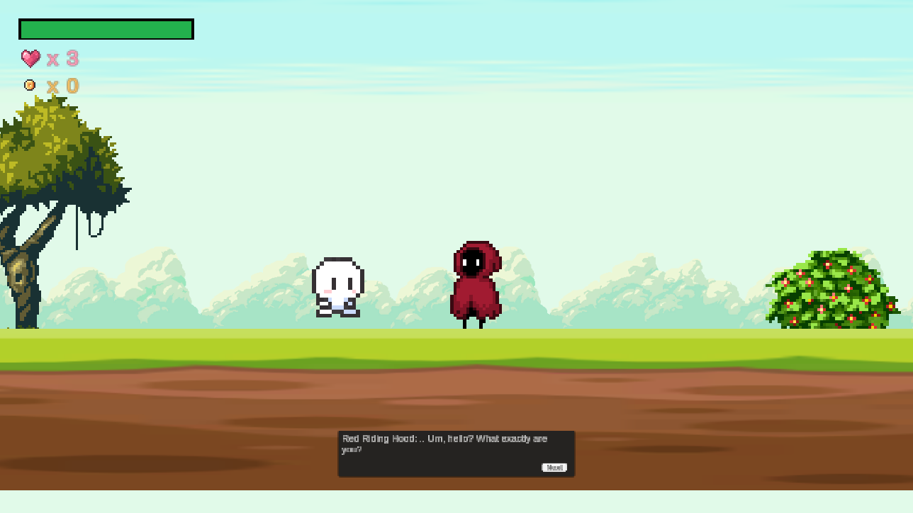

# 2D Unity Lab

**Jump gaps, collect coins, and find your way past dinosaurs and moving saws in a two-level pixel-art platformer.**

[Download for Windows](https://github.com/m4hmvd/Unity-2D-Platformer/releases/latest) · [Screenshots](#screenshots) · [Controls](#controls) · [Open in Unity](#open-in-unity)

Cover illustration inspired by the game.

## Play

Download `Unity-2D-Platformer-Windows-x64.zip` from the [latest release](https://github.com/m4hmvd/Unity-2D-Platformer/releases/latest), extract the whole ZIP, and run `Unity-2D-Platformer.exe` from the extracted folder.

## What you’ll find

- **Level 1.** Pass the moving saw, use checkpoints and a rising platform, and collect the heart to open the way to Level 2. Look for the hooded NPC to start a conversation about the Eternal Dahlia.
- **Level 2.** Cross the platforms, dodge or shoot the teal dinosaurs, and find the final door to reach the victory screen.
- **Pickups and checkpoints.** Coins add to your score. Hearts heal when you’ve taken damage. Checkpoints let you recover after losing health, and your remaining health and lives carry into Level 2.

## Screenshots

| Level 1 · Moving saw | Level 2 · Dinosaur enemy |
| :---: | :---: |
|  |  |

### Hooded NPC dialogue

## Controls

| Action | Input |
| --- | --- |
| Move | **A** / **D** |
| Jump | **Space** |
| Shoot | **Right mouse button** in Level 1, **left mouse button** in Level 2 |
| Zoom | **Mouse wheel** |
| Advance dialogue | Click **Next** |

## Open in Unity

1. Add the project folder in Unity Hub and open it with **Unity 2021.3.10f1**.
2. Open [`Assets/Scenes/Intro.unity`](Assets/Scenes/Intro.unity) and press **Play** to start from the title screen.
3. To build a Windows player, open **File → Build Settings**, select **PC, Mac & Linux Standalone**, choose **Windows** and **x86-64**, and select **Build**.

The build starts at `Intro` and includes `Level1`, `Level2`, `GameOver`, and `Finish`.

Made for the **Game Design and Development** lab at **The British University in Egypt**.

| Folder | Contents |
| --- | --- |
| [`Assets/Scenes`](Assets/Scenes) | Title screen, gameplay levels, and end screens |
| [`Assets/Scripts`](Assets/Scripts) | Movement, combat, dialogue, audio, and level flow |
| [`Assets/Prefabs`](Assets/Prefabs) | Reusable enemies, hazards, and pickups |
