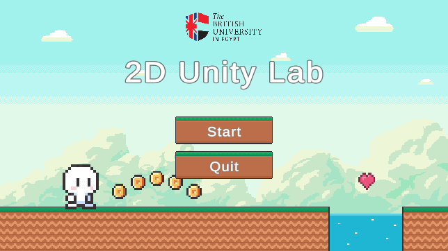
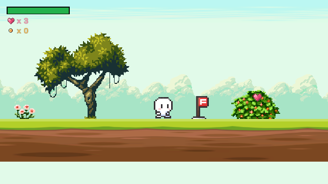
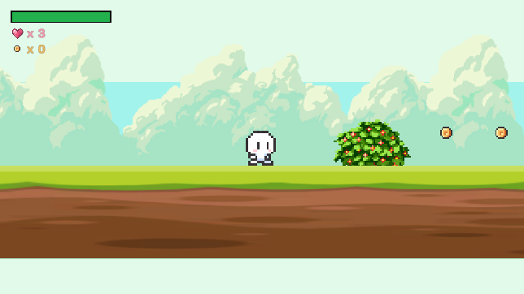

# 2D Unity Lab

**A two-level pixel-art platformer built in Unity for the Game Design and Development lab at The British University in Egypt.**

[Download for Windows](https://github.com/m4hmvd/Unity-2D-Platformer/releases/latest) · [Controls](#controls) · [Open in Unity](#open-in-unity)

## Play

Download `Unity-2D-Platformer-Windows-x64.zip` from the [latest release](https://github.com/m4hmvd/Unity-2D-Platformer/releases/latest), extract the whole ZIP, and run `Unity-2D-Platformer.exe` from the extracted folder.

Collect coins to raise your score, use checkpoints to recover from hazards, and grab the heart in Level 1 to unlock the next area. Your remaining lives and health carry into Level 2. Find the final door to reach the victory screen.

## Screenshots

| Level 1 | Level 2 |
| :---: | :---: |
|  |  |

## Controls

| Action | Input |
| --- | --- |
| Move | **A** / **D** |
| Jump | **Space** |
| Shoot | **Right mouse button** in Level 1, **left mouse button** in Level 2 |
| Zoom | **Mouse wheel** |
| Advance dialogue | Click **Next** |

## Open in Unity

1. Add the project folder in Unity Hub and open it with **Unity 2021.3.10f1**.
2. Open [`Assets/Scenes/Intro.unity`](Assets/Scenes/Intro.unity) and press **Play** to start from the title screen.
3. To build a Windows player, open **File → Build Settings**, select **PC, Mac & Linux Standalone**, choose **Windows** and **x86-64**, and select **Build**.

The build starts at `Intro` and includes `Level1`, `Level2`, `GameOver`, and `Finish`.

| Folder | Contents |
| --- | --- |
| [`Assets/Scenes`](Assets/Scenes) | Title screen, gameplay levels, and end screens |
| [`Assets/Scripts`](Assets/Scripts) | Movement, combat, dialogue, audio, and level flow |
| [`Assets/Prefabs`](Assets/Prefabs) | Reusable enemies, hazards, and pickups |
